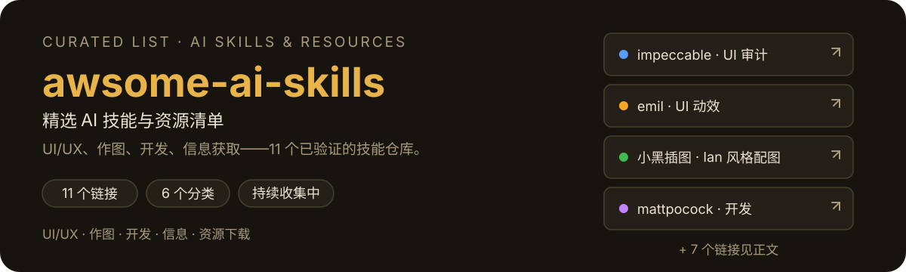

<a href="README.en.md">English</a>

  

  <a href="#ui--ux">UI/UX</a>
  ·
  <a href="#作图">作图</a>
  ·
  <a href="#开发">开发</a>
  ·
  <a href="#信息">信息</a>
  ·
  <a href="#资源下载">资源下载</a>

个人精选的 AI 技能与资源清单：用得上的技能仓库、插画风格与工具，按主题收着，找的时候不用翻聊天记录。11 个链接已逐个验证可达（2026-11-17）。

## UI / UX

| 资源 | 说明 |
| --- | --- |
| [impeccable](https://github.com/pbakaus/impeccable) | 前端界面设计与打磨 |
| [emilkowalski/skills](https://github.com/emilkowalski/skills) | UI 与动效 |
| [detaildotdesign/skill](https://github.com/detaildotdesign/skill) | UI 与动效 |
| [jakubkrehel/skills](https://github.com/jakubkrehel/skills) | UI 与动效 |

## 作图

| 资源 | 说明 |
| --- | --- |
| [小黑插图](https://github.com/helloianneo/ian-xiaohei-illustrations) | Ian 风格宇航员小黑插画 |
| [塞尔达风格](https://github.com/ekkojiang/zelda-screenshot-transfer) | 塞尔达风格截图转绘 |
| [双色画](https://github.com/yanliudesign/mono-color-skill) | 单色 / 双色画技能 |
| 版画 | 链接待补 |
| 橡皮图章 | 链接待补 |

## 发布

_待补充。_

## 开发

| 资源 | 说明 |
| --- | --- |
| [mattpocock/skills](https://github.com/mattpocock/skills) | 开发技能 |
| [beautify-github-readme](https://github.com/oil-oil/beautify-github-readme) | 优化 README，增加动图 |

## 信息

| 资源 | 说明 |
| --- | --- |
| [last30days-skill](https://github.com/mvanhorn/last30days-skill) | 最近 30 天信息汇总 |

## 资源下载

| 资源 | 说明 |
| --- | --- |
| [dedao-dl](https://github.com/yann0917/dedao-dl) | 得到课程下载 |
